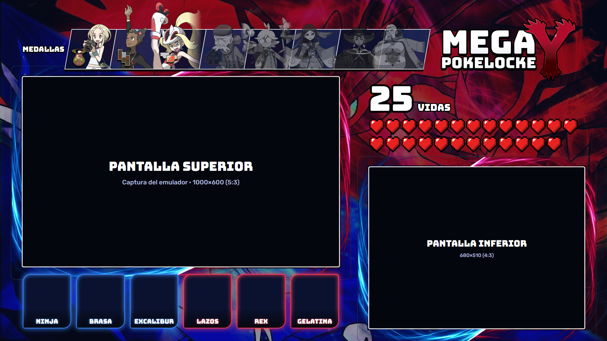

# Mega Pokelocke Y

App para jugar un Nuzlocke de Pokémon Y en el emulador de 3DS Azahar con el layout del stream
(1920×1080): biblioteca de juegos, randomizador, pantallas colocadas en su sitio y seguimiento del locke.



## Instalar (para jugar)

Un solo paso y nada más que instalar: **PokelockeSetup.exe** lleva la app, el emulador (Citra con su lanzador),
el randomizador, el Java que usa el randomizador y makerom. Se instala sin permisos de administrador en
`%LOCALAPPDATA%\Pokelocke` y deja Pokelocke en el menú Inicio y en el escritorio.

- Con el enlace del anfitrión: abre `http://pokelocke-david.duckdns.org:8766/descargar` y ejecuta lo que se baja.
- O con un solo comando en PowerShell (lo baja y lo instala sin preguntar):

```
irm http://pokelocke-david.duckdns.org:8766/descargar -OutFile "$env:TEMP\PokelockeSetup.exe"; & "$env:TEMP\PokelockeSetup.exe" /SILENT
```

Para actualizar, igual: se instala encima y las partidas se quedan.

## Requisitos

- Windows 10 u 11 de 64 bits.
- Tu ROM de Pokémon Y **descifrada** (`.3ds`, `.cci`, `.cxi` o `.cia`), esté donde esté. Un `.cia`
  se convierte solo a `.cci` con makerom y se guarda en
  `datos/juegos/<id>/rom.cci`, porque el randomizador no abre `.cia`. Un `.cia` **cifrado** no sirve:
  descífralo antes en la 3DS con GodMode9.

## Uso

1. Abre **`Pokelocke.exe`**. Se abre la biblioteca de juegos en una ventana propia (Edge en
   modo aplicación, con su perfil dentro de `tools/`).
2. **+ Añadir juego** abre el explorador de archivos: elige tu ROM.
3. La primera vez que juegas una ROM sale la pantalla de preparación: vidas (25 por defecto)
   y randomización. Pulsa **Continuar**.
   - Si faltan Azahar o el randomizador, se descargan solos en `tools/`.
   - El juego randomizado se guarda como mod (LayeredFS) en `datos/juegos/<id>/`. La ROM original no se toca.
   - El registro de la randomización queda en `datos/juegos/<id>/randomizacion.log`.
4. Se abre Azahar a pantalla completa con **las dos pantallas ya colocadas en los huecos del
   layout**, y el layout encima. El layout no coge el foco: el teclado va al juego y la pantalla
   táctil se puede pulsar a través del hueco. Al cerrar Azahar se cierra el layout.
5. Mientras juegas, corrige el locke con el teclado, sin salir del juego:
   **F7** quita una vida y **F8** añade una. Los atajos solo están activos con un juego abierto.
   - **Vial** (al lado de las vidas): **E** cura a todo el equipo vivo (PS, estado y PP). Los
     debilitados no reviven. Tiene una sola carga: se pone gris al usarlo y se recarga solo cuando te
     curas en un Centro Pokémon. La E solo se captura con la ventana del
     juego delante (Azahar no la usa; la V es su botón de encendido). Durante un combate el juego usa
     una copia del equipo, así que el efecto se nota al terminar la batalla.
6. Para el stream, captura la pantalla completa en OBS. Si prefieres montar tú las capturas, el
   overlay está en `http://localhost:8765/overlay` (fuente de navegador, 1920×1080) y los huecos son:

| Pantalla | Tamaño | Posición |
|---|---|---|
| Superior (5:3) | 1000×600 | x=72, y=244 |
| Inferior (4:3) | 680×510 | x=1168, y=530 |

Cada juego de la biblioteca guarda su propio locke en `datos/biblioteca.json`. **Nuevo locke**
vuelve a pedir vidas y randomización.

Si el monitor no es de 1920×1080, el layout se escala y se centra, y las pantallas de Azahar se
colocan a la misma escala.

## Usar Citra en vez de Azahar

Azahar no abre ROMs cuya cabecera dice «cifrada» (error 8 en su registro). Un Citra antiguo (probado con
Nightly 1920) sí, y Pokelocke lo usa si se pone en el sitio de Azahar:

1. Copia la carpeta de Citra a `tools\azahar\citra-1920\` (y mueve fuera la de Azahar).
2. Compila el lanzador como `azahar.exe` junto a `citra-qt.exe`:
   `C:\Windows\Microsoft.NET\Framework64\v4.0.30319\csc.exe /target:winexe /out:azahar.exe app\citra\lanzador.cs`

El lanzador quita el `-f` que este Citra no entiende, corrige los ajustes que Pokelocke escribe para Azahar,
pinta el juego en una ventana sin bordes por debajo del layout (la pantalla completa de Citra lo tapa) y con
**Alt+Q** cambia a ventana normal. Este Citra habla el protocolo RPC 1 (lecturas de 32 bytes): Pokelocke lo
detecta solo.

## Qué se actualiza solo

- **Equipo**: se lee de la memoria del juego cada segundo, mediante el servidor RPC de Azahar,
  que la app activa. Los huecos vacíos salen en negro.
- **Vidas**: cada Pokémon que llega a 0 PS resta una vida, una sola vez aunque luego lo revivas.
- **Medallas**: se leen de la memoria del juego (bloque del entrenador, un bit por medalla) y se pintan en
  cuanto vences al líder. Antes iban con F9.

## Arte del equipo

Cada carta usa el arte oficial de su especie, que se descarga una vez a `tools/arte/`. Para usar
un fanart, déjalo en `fanart/` con el número de la Pokédex nacional (`fanart/658.png` para
Greninja) o pégalo, con cualquier nombre, dentro de la carpeta de ese Pokémon (`fanart/658 Greninja/`).
Hay una carpeta para cada Pokémon de la Pokédex de Kalos; si tiene varias imágenes, se usa la primera
por orden alfabético. Admite `.png`, `.jpg` o `.webp`. La carpeta no se sube al repositorio. Usad fanart
con permiso de sus autores y acreditadlo en el stream.

## Repartir Pokelocke (instalador)

`tools\build-venv\Scripts\python app\empaquetar.py` crea `tools\instalador\PokelockeSetup.exe`. Necesita
Citra 1920 con su lanzador en `tools\azahar\citra-1920` e Inno Setup 6 (`ISCC.exe` en `tools\inno`, en scoop
como `inno-setup` o instalado).

- La app va en modo carpeta (PyInstaller `--onedir`): no se descomprime nada al abrirla. El modo de un solo
  archivo lo sacaba todo a `%TEMP%` en cada arranque (y otra vez al jugar, por la capa): era lento y es lo que
  más marcan los antivirus.
- El instalador no pide administrador y deja Pokelocke en `%LOCALAPPDATA%\Pokelocke`, la carpeta de siempre:
  las partidas (`datos\` y el `user\` de Citra) no van en él, así que actualizar o desinstalar no las toca.
  Pone accesos directos en Inicio y, si se quiere, en el escritorio.
- Los .exe llevan editor y versión. Para firmarlos (lo único que quita el aviso de SmartScreen), define
  `POKELOCKE_FIRMA` con la orden de firma, con `{archivo}` donde va el archivo; por ejemplo
  `signtool sign /fd sha256 /tr http://timestamp.acs.microsoft.com /td sha256 /a "{archivo}"`.
- El online va cifrado: al construir, si el PC no tiene, se crea un certificado propio del servidor (la clave privada
  se queda en `%LOCALAPPDATA%\Pokelocke\datos\servidor` y nunca va en el instalador) y el instalador lleva el
  certificado: los Pokelocke de los demás solo hablan con ese servidor. Puertos: TCP 8767 (https, todo), TCP 8766
  (http, solo la primera descarga del instalador) y UDP 24872 (la sala de Citra); la app los abre con UPnP.
  Si se cambia de PC anfitrión, hay que construir el instalador en el nuevo y repartirlo otra vez.
- No lleva la ROM (cada uno elige la suya). Sí lleva un Java mínimo hecho con jlink y LockeSettings y MegaFases
  compilados, así que no hay que instalar Java (para construir hace falta un JDK 17 o superior).

Con el servidor encendido, el anfitrión reparte el instalador en `/descargar` (ver «Instalar»;
`empaquetar.py` lo deja junto a su Pokelocke instalado). El enlace en el navegador levanta menos sospechas que el
comando de PowerShell: descargar un .exe desde PowerShell es justo lo que vigilan los antivirus.

En la copia de desarrollo (sin instalador) la app sigue descargando lo que falte en `tools\`: un JDK si no hay
ninguno, makerom y el randomizador.

## Carpetas

| Carpeta | Contenido | ¿En git? |
|---|---|---|
| `Pokelocke.exe` | La app. `app/construir.bat` la vuelve a crear con PyInstaller (en `tools/build-venv`). `Pokelocke.bat` arranca lo mismo con Python | Sí |
| `app/` | Servidor y capa (`main.py`), lectura del juego (`juego.py`), ajustes del UPR (`LockeSettings.java`) y páginas web | Sí |
| `assets/` | Fondo, marcos, logo, líderes y medallas del overlay | Sí |
| `index.html` | Overlay estático, la foto del diseño | Sí |
| `tools/` | Azahar, randomizador, perfiles de Edge, caché de arte, entorno de construcción | No |
| `datos/`, `fanart/` | Biblioteca, lockes, mods randomizados y tus fanarts | No |

Prueba del descifrado de Pokémon: `py -3 app\test_juego.py`.

## Créditos

- Lectura de memoria: protocolo RPC de [Azahar](https://github.com/azahar-emu/azahar); direcciones y
  descifrado PK6 de [CitraRNG](https://github.com/Admiral-Fish/CitraRNG).
- Randomización: [Universal Pokemon Randomizer ZX](https://github.com/Ajarmar/universal-pokemon-randomizer-zx).
- Pikachu corriendo del modal de carga: sprite de Pokémon Mystery Dungeon (Chunsoft), recopilado por [PMDCollab SpriteCollab](https://github.com/PMDCollab/SpriteCollab).
- Líderes, medallas, logo de Pokémon Y y arte oficial de los Pokémon: © Nintendo / Game Freak / The Pokémon Company.
- Fondo de Xerneas e Yveltal: wallpaper de fans encontrado en internet.
- Marcos, contenedores y corazón pixel art: generados con Adobe Firefly y retocados.
- Uso no comercial, para streams entre amigos.
